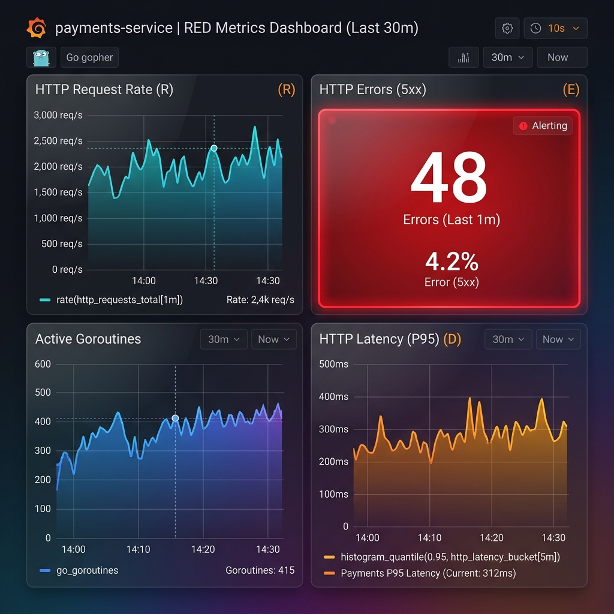
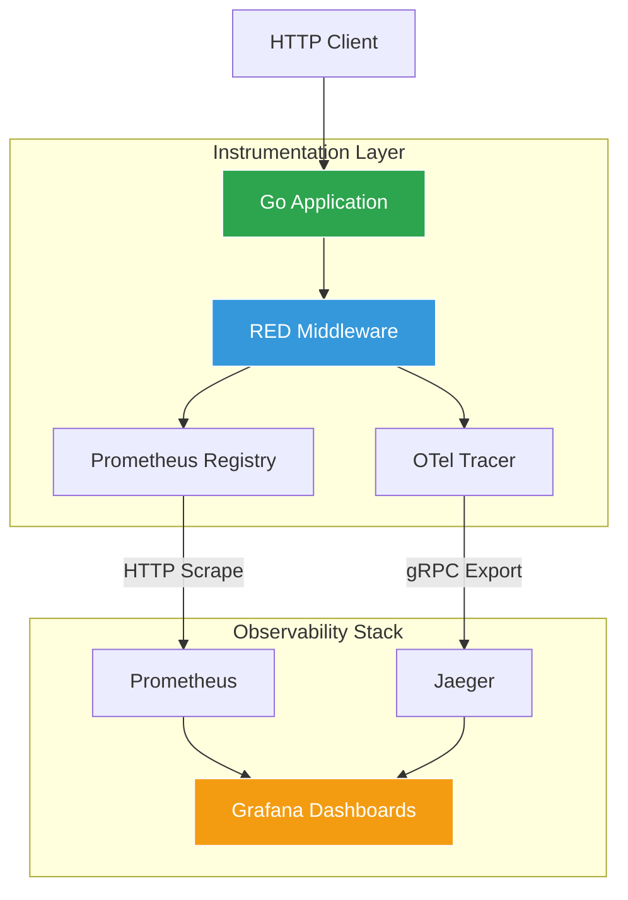

<div align="center">
  <h1>Go Observability Stack</h1>
  <p>Reference implementation for observability in Go — RED metrics, OTel tracing, Prometheus, Jaeger, and Grafana in a single, composed stack.</p>

  

  <br>

  
  [](https://goreportcard.com/report/github.com/ESousa97/goobservabilitystack)
  [](https://www.codefactor.io/repository/github/esousa97/goobservabilitystack)
  [](https://pkg.go.dev/github.com/ESousa97/goobservabilitystack)
  
  
  
</div>

---

**goobservabilitystack** is a minimal and correct foundation for instrumenting HTTP services in Go. The project demonstrates the RED pattern (Rate, Errors, Duration) using Prometheus metrics and OpenTelemetry distributed tracing, with a clear separation between transport, business logic, and telemetry layers. Designed for low CPU and memory overhead in high-throughput infrastructures.

## Technologies & Frameworks

<div align="center">
  
  
  
  
  
  
  
</div>

## Development Roadmap

- [x] **Phase 1: The Expositor (Prometheus Registry)**
  - **Objective:** Foundation with `prometheus/client_golang` and isolated metrics exposure.
  - **Status:** Custom registry configuration and `/metrics` exposure with background event counter completed.

- [x] **Phase 2: Custom Instrumentation (Gauges and Histograms)**
  - **Objective:** Use of semantic metric types to measure internal health.
  - **Status:** Processing latency measurement via Histogram and goroutine monitoring via Gauge implemented.

- [x] **Phase 3: Distributed Tracing (OpenTelemetry and Spans)**
  - **Objective:** OpenTelemetry SDK integration for granular operational visibility.
  - **Status:** Implementation of spans detailing task execution and status attributes completed.

- [x] **Phase 4: The RED Pattern (Monitoring Middleware)**
  - **Objective:** Automation of HTTP telemetry for any registered route.
  - **Status:** Agnostic HTTP middleware for automatic capture of Rate, Errors, and Duration (RED) finished.

- [x] **Phase 5: The Ecosystem (Grafana, Jaeger, and Docker)**
  - **Objective:** Unification of collectors, visualizers, and the application via Docker.
  - **Status:** Total integration via Docker Compose with gRPC trace export and pre-provisioned Grafana dashboards.

## Quick Start

### Prerequisites

- **Go 1.25+**
- **Docker and Docker Compose**
- **golangci-lint & govulncheck**

### Installation

```bash
git clone https://github.com/ESousa97/goobservabilitystack.git
cd goobservabilitystack
make deps
make build
```

### Running (Full Stack)

To start the server along with Prometheus, Jaeger, and Grafana, run:

```bash
make up
```

| Service | URL |
|---|---|
| **Application** | http://localhost:8080 |
| **Metrics** | http://localhost:9091/metrics |
| **Prometheus** | http://localhost:9090 |
| **Jaeger UI** | http://localhost:16686 |
| **Grafana** | http://localhost:3000 (admin / admin) |

### Demo

Verify the running service and observability data:

```bash
# Health check
curl -i http://localhost:8080/healthz

# Prometheus metrics
curl -s http://localhost:9091/metrics | grep http_requests_total
```



## Makefile Targets

| Target | Description |
|---|---|
| `make deps` | Downloads and tidies Go module dependencies |
| `make build` | Compiles the server binary to `bin/goobservabilitystack` |
| `make test` | Runs all tests with the race detector enabled |
| `make lint` | Runs `golangci-lint` across all packages |
| `make up` | Compiles and starts the full stack with Docker Compose |
| `make down` | Stops and removes the Docker containers |

## Architecture

The project follows a modular structure focused on separation of concerns, ensuring telemetry doesn't leak into business logic.

<div align="center">



</div>

- `cmd/server`: Entry point; orchestrates dependencies and starts HTTP servers.
- `internal/metrics`: Custom Prometheus registry and metric definitions.
- `internal/middleware`: RED HTTP middleware for rate, error, and latency capture.
- `internal/tracing`: OTel Tracer provider configured for gRPC export.
- `deploy`: Infrastructure configurations (Prometheus and Grafana provisioning).

## Configuration

| Variable | Type | Default | Description |
|---|---|---|---|
| `HTTP_PORT` | string | `8080` | Application HTTP server port |
| `METRICS_PORT` | string | `9091` | Prometheus scrape port `/metrics` |
| `JAEGER_ENDPOINT` | string | `localhost:4317` | Jaeger collector gRPC endpoint |
| `SERVICE_NAME` | string | `goobservabilitystack` | Service name for OpenTelemetry attributes |

## API Reference

| Method | Path | Port | Description |
|---|---|---|---|
| `GET` | `/healthz` | `8080` | Health check — returns `200 OK` |
| `GET` | `/metrics` | `9091` | Metrics exposure in Prometheus format |

## License

Distributed under the MIT License. See `LICENSE` for more information.

<div align="center">

## Author

**Enoque Sousa**

[](https://www.linkedin.com/in/enoque-sousa-bb89aa168/)
[](https://github.com/ESousa97)
[](https://enoquesousa.vercel.app)

**[⬆ Back to Top](#go-observability-stack)**

Made with ❤️ by [Enoque Sousa](https://github.com/ESousa97)

**Project Status:** Archived — Study Project

</div>
