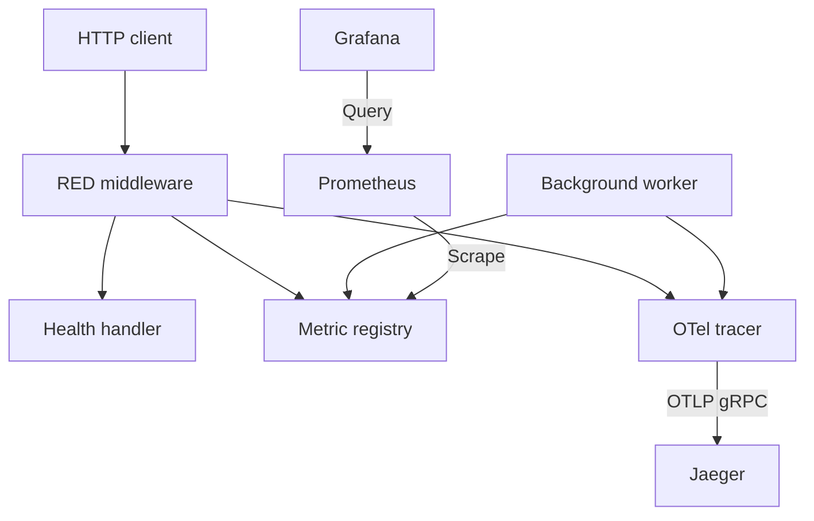

<div align="center">
  <h1>Go Observability Stack</h1>
  <p>Reference implementation for observability in Go — RED metrics, OTel tracing, Prometheus, Jaeger, and Grafana in a single, composed stack.</p>

  

  <br>

  
  [](https://www.codefactor.io/repository/github/enoquesousa/goobservabilitystack)
  [](https://pkg.go.dev/github.com/enoquesousa/goobservabilitystack)
  
  
  
</div>

---

**goobservabilitystack** is a minimal and correct foundation for instrumenting HTTP services in Go. The project demonstrates the RED pattern (Rate, Errors, Duration) using Prometheus metrics and OpenTelemetry distributed tracing, with a clear separation between transport, business logic, and telemetry layers. Designed for low CPU and memory overhead in high-throughput infrastructures.

## Technologies & Frameworks

<div align="center">
  
  
  
  
  
  
  
</div>

## Development Roadmap

- [x] **Phase 1: The Expositor (Prometheus Registry)**
  - **Objective:** Foundation with `prometheus/client_golang` and isolated metrics exposure.
  - **Status:** Custom registry configuration and `/metrics` exposure with background event counter completed.

- [x] **Phase 2: Custom Instrumentation (Gauges and Histograms)**
  - **Objective:** Use of semantic metric types to measure internal health.
  - **Status:** Processing latency measurement via Histogram and goroutine monitoring via Gauge implemented.

- [x] **Phase 3: Distributed Tracing (OpenTelemetry and Spans)**
  - **Objective:** OpenTelemetry SDK integration for granular operational visibility.
  - **Status:** Implementation of spans detailing task execution and status attributes completed.

- [x] **Phase 4: The RED Pattern (Monitoring Middleware)**
  - **Objective:** Automation of HTTP telemetry for any registered route.
  - **Status:** Agnostic HTTP middleware for automatic capture of Rate, Errors, and Duration (RED) finished.

- [x] **Phase 5: The Ecosystem (Grafana, Jaeger, and Docker)**
  - **Objective:** Unification of collectors, visualizers, and the application via Docker.
  - **Status:** Total integration via Docker Compose with gRPC trace export and pre-provisioned Grafana dashboards.

## Quick Start

### Prerequisites

- **Go 1.26.10+**
- **Docker and Docker Compose**
- **golangci-lint & govulncheck**

### Installation

```bash
git clone https://github.com/enoquesousa/goobservabilitystack.git
cd goobservabilitystack
make deps
make build
```

### Running (Full Stack)

The demo publishes every port on `127.0.0.1` and requires an administrator
password for Grafana. In a Bash terminal, enter a unique password from your
password manager; it is not echoed or placed in shell history:

```bash
read -r -s -p "Grafana admin password: " GRAFANA_ADMIN_PASSWORD
printf '\n'
export GRAFANA_ADMIN_PASSWORD
make up
```

Compose refuses to start when the variable is missing or empty. Keep it set for
subsequent Compose commands, including `make down`, then unset it when finished.
The password initializes Grafana's administrator account on
[first startup](https://grafana.com/docs/grafana/latest/setup-grafana/configure-grafana/#admin_password); changing the variable
does not reset a password already stored in Grafana's database. Use Grafana's
account settings or administrative reset procedure for an existing account.

This is a local demonstration. Application HTTP, Prometheus, Jaeger ingestion and
the Jaeger UI do not implement a login. Their boundary is the local host and the
trusted Compose network. Grafana's own login protects its UI only.

| Service | URL |
|---|---|
| **Application** | http://127.0.0.1:8080/healthz |
| **Metrics** | http://127.0.0.1:9091/metrics |
| **Prometheus** | http://127.0.0.1:9090 |
| **Jaeger UI** | http://127.0.0.1:16686 |
| **Grafana** | http://127.0.0.1:3000 — user `admin`, password entered above |

### Running the Go Server Directly

Both native HTTP listeners bind to `127.0.0.1` by default. When using the local
Jaeger collector started by Compose, explicitly select its plaintext endpoint:

```bash
OTEL_EXPORTER_OTLP_ENDPOINT=http://127.0.0.1:4317 go run ./cmd/server
```

Run this separately from the Compose `app` service, or choose other `HTTP_PORT`
and `METRICS_PORT` values to avoid binding the same ports. Without an endpoint
override, OTLP uses TLS at `https://localhost:4317`.

### Demo

Verify the running service and observability data:

```bash
# Health check
curl -i http://127.0.0.1:8080/healthz

# Prometheus metrics
curl -s http://127.0.0.1:9091/metrics | grep http_requests_total
```


## Makefile Targets

| Target | Description |
|---|---|
| `make deps` | Downloads and tidies Go module dependencies |
| `make build` | Compiles the server binary to `bin/goobservabilitystack` |
| `make test` | Runs all tests with the race detector enabled |
| `make lint` | Runs `golangci-lint` across all packages |
| `make up` | Compiles and starts the full stack with Docker Compose |
| `make down` | Stops and removes the Docker containers |

## Architecture

The HTTP application, metric registry and trace exporter have separate roles:

<div align="center">



</div>

- `cmd/server`: Entry point; orchestrates dependencies and starts HTTP servers.
- `internal/config`: Validates HTTP listener configuration before telemetry or workers start.
- `internal/metrics`: Custom Prometheus registry and metric definitions.
- `internal/middleware`: RED HTTP middleware for rate, error, and latency capture.
- `internal/tracing`: OTel Tracer provider configured for gRPC export.
- `deploy`: Infrastructure configurations (Prometheus and Grafana provisioning).

An application request reaches the RED middleware, which records metrics and
opens a server span around the health handler. Prometheus reads the separate
`/metrics` listener; Grafana queries Prometheus through its provisioned datasource.
HTTP spans and background-worker spans are batched and exported to Jaeger.
The provisioned Grafana configuration does not include a Jaeger datasource.

Incoming `traceparent`, `tracestate` and `baggage` provide tracing context. They do
not authenticate a caller. The Go application creates no user account, session,
JWT or refresh token.

## Configuration

| Variable | Type | Default | Description |
|---|---|---|---|
| `HTTP_HOST` | string | `127.0.0.1` | Application bind IP or hostname; remote binding requires an explicit value |
| `HTTP_PORT` | string | `8080` | Application HTTP server port |
| `METRICS_HOST` | string | `127.0.0.1` | Metrics bind IP or hostname |
| `METRICS_PORT` | string | `9091` | Prometheus scrape port `/metrics` |
| `OTEL_EXPORTER_OTLP_ENDPOINT` | URL | `https://localhost:4317` | OTLP gRPC collector; `http://` explicitly selects plaintext |
| `OTEL_EXPORTER_OTLP_CERTIFICATE` | file path | system trust | PEM CA certificate(s) used to verify the collector |
| `OTEL_EXPORTER_OTLP_CLIENT_CERTIFICATE` | file path | unset | PEM client certificate for mTLS; requires a matching client key |
| `OTEL_EXPORTER_OTLP_CLIENT_KEY` | file path | unset | PEM private key for mTLS; requires a client certificate |
| `OTEL_EXPORTER_OTLP_HEADERS` | string | unset | Standard comma-separated, URL-encoded collector metadata; requires TLS |
| `GRAFANA_ADMIN_PASSWORD` | secret | required by Compose | Initial Grafana administrator password; not read by the Go server |

The standard `OTEL_EXPORTER_OTLP_TRACES_*` variants take precedence for traces.
Both generic and trace-specific values must be valid, even when a valid
trace-specific setting would override a malformed generic value: the SDK reads
both before constructing its client.
`OTEL_EXPORTER_OTLP_INSECURE` and its trace-specific variant are also recognized;
use the endpoint scheme to make the transport choice explicit. Conflicting
scheme and insecure settings are rejected in either direction when both are
explicitly configured. With no endpoint override, `INSECURE=true` explicitly
selects plaintext at `localhost:4317`. CA files, client identity material and
non-empty custom headers are rejected for plaintext export.

Empty HTTP host or port variables use the defaults above. Ports must be decimal
numbers from 0 to 65535; 0 asks the OS to assign an ephemeral port. Use an
unbracketed IPv6 address in the host variable, such as `::1`; configuration builds
the address with `net.JoinHostPort`. Schemes, paths, embedded ports and IPv6 zones
are not accepted as host values.

`JAEGER_ENDPOINT` and `SERVICE_NAME` are not configuration variables in this
application. The service name is `goobservabilitystack`.

### TLS and Collector Credentials

For a collector with a private CA and mTLS enabled, provide readable files and
an endpoint whose hostname appears in the server certificate's SAN:

```bash
export OTEL_EXPORTER_OTLP_ENDPOINT=https://collector.example.net:4317
export OTEL_EXPORTER_OTLP_CERTIFICATE=/run/secrets/collector-ca.crt
export OTEL_EXPORTER_OTLP_CLIENT_CERTIFICATE=/run/secrets/client.crt
export OTEL_EXPORTER_OTLP_CLIENT_KEY=/run/secrets/client.key
./bin/goobservabilitystack
```

The CA authenticates the collector. In mTLS, the collector verifies the client
certificate using its own trust policy. This application does not implement
collector-side authorization. Custom authorization metadata can be supplied
through the standard OTLP headers variable when required by the collector;
provide that value through your secret manager, without putting a real token in
a command argument, URL, repository file or log.

Configuration is read at startup. Unreadable or unparseable TLS files, an incomplete identity pair,
malformed transport settings or malformed headers stop initialization with a
fixed error message. The SDK connects lazily: an unreachable collector, an
untrusted server certificate or a SAN mismatch fails export/flush and never
falls back to plaintext. Restart after rotating credentials or certificates.
The application does not issue or refresh collector tokens.

The Compose demo opts into plaintext OTLP only between `app` and `jaeger` on its
trusted bridge. The app binds to `0.0.0.0` inside that network so Prometheus can
scrape it, while host port mappings remain on `127.0.0.1`. Other containers on
that bridge can still reach these unauthenticated services. For a shared or
remote deployment, apply network isolation and appropriate TLS/authentication
at each service or proxy; changing a bind address alone does not add a login.

Grafana's demo password is supplied as a container environment variable. Docker
administrators can inspect it, and resolved `docker compose config` output may
include it; do not share that output. A deployment can instead use Grafana's
[file-based secret configuration](https://grafana.com/docs/grafana/latest/setup-grafana/configure-docker/#configure-grafana-with-docker-secrets).
The build context excludes `.env` files, certificate/key directories and private
key patterns. Protect secret files on disk and mount them read-only at runtime.

## API Reference

| Method | Path | Port | Description |
|---|---|---|---|
| `GET` | `/healthz` | `8080` | Health check — returns `200 OK` |
| `GET` | `/metrics` | `9091` | Metrics exposure in Prometheus format |

## License

Distributed under the MIT License. See `LICENSE` for more information.

<div align="center">

## Author

**Enoque Sousa**

[](https://www.linkedin.com/in/enoque-sousa-bb89aa168/)
[](https://github.com/enoquesousa)
[](https://enoquesousa.vercel.app)

**[⬆ Back to Top](#go-observability-stack)**

Made with ❤️ by [Enoque Sousa](https://github.com/enoquesousa)

**Project Status:** Archived — Study Project

</div>
